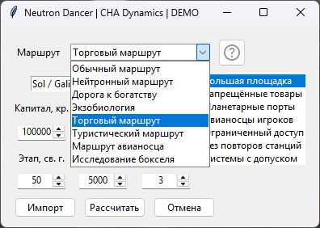
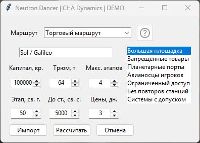

# Neutron Dancer по-русски

**CHA Dynamics Elite Dangerous** · Неофициальная русская локализация Neutron Dancer 2.1.2 для ED Market Connector. Автор плагина — **dwomble**. Переведены восемь режимов, параметры торговли, подсказки, таблица результата, настройки и справка. Названия систем и станций можно копировать в игру в исходном виде.

[Скачать комплект перевода](https://github.com/RacerCHA/cha-dynamics-elite-neutron-dancer-ru/releases/download/v2.1.2-ru.1/NeutronDancer-RU-2.1.2-ru.1.zip) · [Оригинал v2.1.2](https://github.com/dwomble/EDMC-NeutronDancer/releases/tag/v2.1.2) · [Витрина CHA Dynamics](https://github.com/RacerCHA/cha-dynamics-elite-dangerous)

| Выбор режима | Торговый маршрут |
| --- | --- |
|  |  |

На снимках настоящая форма плагина в отдельном демонстрационном окне. Станция, капитал и вместимость заданы для примера.

## Установка в Windows

1. Скачайте **NeutronDancer-RU-2.1.2-ru.1.zip** по ссылке выше. Извлеките его в отдельную папку и откройте вложенную папку с **build.py**.
2. Скачайте [официальный EDMC-NeutronDancer.zip](https://github.com/dwomble/EDMC-NeutronDancer/releases/download/v2.1.2/EDMC-NeutronDancer.zip). Положите скачанный архив рядом с **build.py**, сохранив его имя.
3. Для сборки нужен Python 3.8 или новее. Откройте терминал в папке с **build.py** и выполните `py -3 build.py`. Если Python установлен под именем `python`, используйте `python build.py`. Дополнительные пакеты не нужны. Появится **EDMC-NeutronDancer-2.1.2-ru.zip**. Сборщик проверяет оригинал и каждый изменённый файл. Если выходной ZIP уже существует, переместите его перед повторной сборкой.
4. В EDMC откройте **Файл → Настройки → Плагины** и перейдите в указанную папку плагинов. Обычное расположение в Windows — `%LOCALAPPDATA%\EDMarketConnector\plugins`. Оставьте папку открытой и завершите EDMC через **Файл → Выход**.
5. При первой установке извлеките содержимое **собранного ZIP** прямо в папку плагинов. Если Neutron Dancer уже установлен, сначала сохраните его папку целиком **за пределами** `plugins`. Для версии 2.1.2 скопируйте содержимое собранной папки поверх существующего плагина, сохранив имя каталога и локальные данные. Для иной версии переместите старую папку за пределы `plugins` и установите 2.1.2 отдельно. В активной папке должна остаться одна копия Neutron Dancer.
6. Для стандартного имени правильный путь — `plugins/EDMC-NeutronDancer/load.py`. Если перед `load.py` есть ещё одна вложенная папка, переместите содержимое на уровень выше. Запустите EDMC. Нажмите **«Построить маршрут»** и откройте список режимов.

## Первый маршрут

Для обычного перелёта выберите **«Обычный маршрут»**, укажите, например, **Sol** и **Alpha Centauri**, выберите свой корабль и нажмите **«Рассчитать»**. Если список кораблей пуст, дождитесь получения EDMC данных о снаряжении из игры.

Для торговли выберите **«Торговый маршрут»**. Начните вводить **Galileo** и выберите **Sol / Galileo** из подсказок. Для примера задайте **100 000 кр.**, **64 т**, **4 этапа** и цены не старше **3 дней**. При необходимости выберите большую площадку. Нажмите **«Рассчитать»**. Наличие сделок зависит от рынка и ограничений. Нажмите «Показать». В таблице результата появятся станции, товары, объёмы и прибыль. Нажатие на строку копирует значение первого столбца.

## Совместимость, обновления и данные

В Windows проверена связка **EDMC 6.1.2 + Neutron Dancer 2.1.2**. Русские формы и список режимов проверены в запущенном EDMC. Торговый запрос и обработка ответа проверены на тестовых данных. Обновление оригинального плагина может заменить перевод. Этот комплект привязан к версии 2.1.2. Для отката закройте EDMC и верните сохранённую папку плагина.

В комплекте находятся поправки, сборщик, документация, снимки и лицензия. Сборщик работает без сети. Сам плагин обращается к **Spansh** за подсказками, данными систем и расчётом маршрута. В запрос попадают системы, станции и параметры выбранного режима. Для обычного маршрута используются также данные корабля. Оригинальный плагин обращается к GitHub за обновлениями, уведомлениями и данными модулей Coriolis.

## Авторы и исходники

[Neutron Dancer](https://github.com/dwomble/EDMC-NeutronDancer/tree/3c9e130a440453ba4a13546a71867c8596c59632) — © 2025 dwomble, [лицензия MIT](LICENSE). Русская локализация — **CHA Dynamics**. Исходные изменения открыты в `translation.json`, код сборки — в `build.py`. Оригинальные сторонние библиотеки и графику игрок получает в архиве у автора плагина.

Расчёт выполняют [планировщики CMDR Spansh](https://spansh.co.uk/plotter). В основе плагина лежат [Spansh Router от CMDR Kiel42](https://github.com/CMDR-Kiel42/EDMC_SpanshRouter) и версии [RadarCZ](https://github.com/RadarCZ/EDMC_SpanshRouter) и [Norohind](https://github.com/norohind/EDMC_SpanshRouter).
